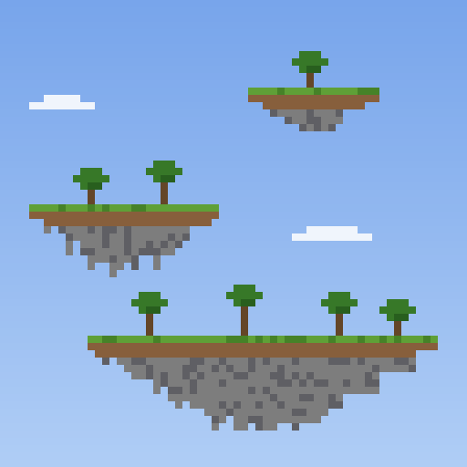
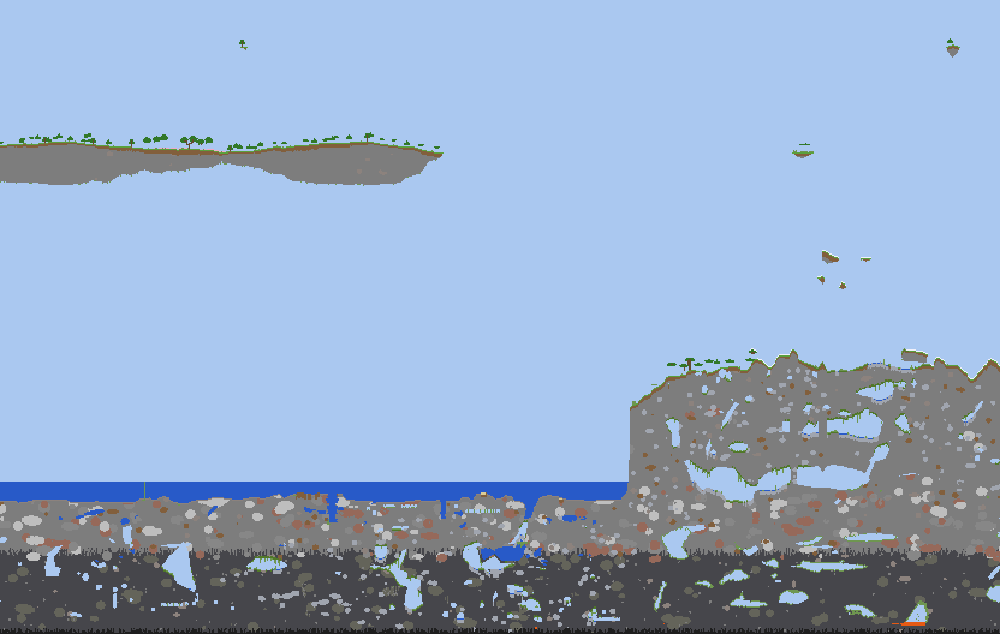

# Sky Strata



A world type for Minecraft 1.21.1 built for airships. If you play with Create Aeronautics or similar mods, you will need them to get anywhere.



By default the world has three layers:

- **Giant islands** (top surface around y 230–280). Floating continents hundreds of blocks across.
- **Dense sky layer** (y 305–375). Frequent large islands.
- **Shards** (y 385–462). A sparse layer of small floating islands.

The ocean, the coast and the ground between the islands keep the vanilla terrain. Trees and grass grow on every level.

Sky light also falls at an angle, so the ground under the edges of floating islands is not dark. It reaches about 16 blocks in under an island. Further in, the space under an island is lit dimly, and brighter the higher the island floats. Caves stay dark. Turn **Island light** off on the Customize screen to keep vanilla lighting.

> **Lighting mods.** Island light hooks into the vanilla sky light engine. Mods that replace the light engine, such as Moonrise, Starlight or ScalableLux, may conflict with it. The game will not crash, but the light under islands may be missing or look wrong. If that happens, turn Island light off for the world.

## Installation

Requires NeoForge for 1.21.1. Download it from [Modrinth](https://modrinth.com/mod/sky-strata), [CurseForge](https://www.curseforge.com/minecraft/mc-mods/sky-strata) or [GitHub Releases](https://github.com/Restor-0o0/sky-strata/releases) and put `skystrata-<version>.jar` into `mods/`. Install it on both the server and the clients.

When creating a world, click **World Type** and pick **Sky Strata**.

Normal worlds are not affected. The mod does not override any vanilla worldgen file.

### Dedicated server

Set this in `server.properties` before the world is created:

```
level-type=skystrata\:sky_strata
```

On first start the server writes `config/skystrata.json` with the default layers:

```json
{
  "preset": "classic"
}
```

Set `preset` to `classic`, `settled`, `archipelago`, `tower`, `giants` or `shattered`, or replace it with your own list of layers (fields as in [Configuring layers](#configuring-layers); `size` is optional and defaults to 1, `landing` is optional, only used by continents and defaults to `floating`; `taper` is optional, only used by landed continents and defaults to 0.75). Add `"island_light": false` to keep vanilla lighting:

```json
{
  "layers": [
    { "kind": "continents", "gap": 32, "thickness": 160, "density": 0.54, "size": 1.0, "landing": "mixed" },
    { "kind": "islands", "gap": 50, "thickness": 70, "density": 0.45 },
    { "kind": "shards", "gap": 10, "thickness": 77, "density": 0.26 }
  ]
}
```

The file is read only when a new world is created. To apply changes, delete the world folder or set a new `level-name`.

## Configuring layers

With **Sky Strata** selected, click **Customize** on the world creation screen. The **Preset** button cycles through ready-made layouts:

- **Classic**: the default three layers described above.
- **Settled**: the same layers, but the giant islands have come down: some stand on the ground on sheer cliffs, others hover low above it. Between them lies the ground they cracked away from, with forests and rivers.
- **Archipelago**: no continents, two island layers with shards above them.
- **Sky Tower**: five layers stacked up to y 699.
- **Giants**: a single layer of huge continents.
- **Shattered**: three sparse shard layers.

The layer list on the left shows each layer's height range; select a layer to edit it on the right. Use **+**, **−**, **↑** and **↓** to add, remove and reorder layers. Up to 8 layers, from bottom to top. Each layer has:

- **Type**: continents, islands or shards.
- **Gap**: distance from the top of the previous layer to the bottom of this one. For the first layer it is counted from sea level (y 63). Negative values let layers overlap.
- **Thickness**: height of the layer in blocks.
- **Density**: how much of the sky the layer fills. For landed continents it sets how narrow the gaps between the islands are.
- **Size**: horizontal scale of the islands.
- **Landing** (continents only): *Floating* keeps the islands in the air, *Settled* stands them on the ground, *Mixed* sets some on the ground and leaves others hovering up to about 40 blocks above it.
- **Taper** (landed continents only): how much the islands narrow toward the ground, from sheer walls at 0% to a sharp cone at 100%.

The world height grows automatically to fit the layers, up to y 2031. The settings are stored in the world and cannot be changed later.

## Compatibility

- The world type has its own copies of the vanilla overworld biomes (`skystrata:forest`, `skystrata:plains`, …). These copies are added to the matching `minecraft:` and `c:` biome tags. Mods that add features, mobs or structures by biome tag work in them.
- Mods that add new biomes through TerraBlender (Biomes O' Plenty, Terralith-as-mod, …) do not inject their biomes into this world type.
- Mods that target vanilla biomes by ID instead of by tag do not apply here. Neither does the *Adventuring Time* advancement.
- Trees on the lower levels (under islands and overhangs) generate without bee nests and cocoa. The vanilla tree decorators for those crash when a tree gets no logs on a crowded layer. Trees on the topmost surface are unchanged.
- With the default layers the world is 528 blocks tall (y −64 … 463).

## Building

The worldgen data is generated by a script from vanilla data. You need Python 3.11+ and Java 21.

```
python setup_vanilla.py   # downloads the 1.21.1 server + NeoForge tags, extracts reference data into vanilla/
python build.py           # writes the generated data into src/generated/resources
./gradlew build           # writes build/libs/skystrata-<version>.jar
```

Tools for testing on a local server (`testserver/`, created by `setup_vanilla.py`; install the NeoForge server into it and put the jar into `testserver/mods/`):

```
# accept the EULA in testserver/eula.txt and set level-type=skystrata\:sky_strata in server.properties first
python tools/run_server.py <radius_chunks> <center_cx> <center_cz>   # pregenerate, report chunks/s
python tools/render.py 528                                           # slices and top views into renders/
```

## Translations

The mod's strings live in `lang/<code>.json` (English, Russian, Ukrainian, German, French, Spanish, Brazilian Portuguese, Polish, Italian, Turkish, Simplified and Traditional Chinese, Japanese, Korean). To add a language, copy `lang/en_us.json` to the new language code, translate it and rerun `setup_vanilla.py` and `build.py`; biome names come from the game's own translations.

## Releasing

Pushing a tag `v<mod_version>` builds the jar and publishes it to GitHub Releases, Modrinth and CurseForge. The release notes come from the matching section of [CHANGELOG.md](CHANGELOG.md). The repository needs two secrets (Settings → Secrets and variables → Actions): `MODRINTH_TOKEN` (a Modrinth PAT with the *Create versions* scope) and `CURSEFORGE_TOKEN` (an API token from CurseForge account settings).

A platform whose token is missing is skipped.

## License

MIT
